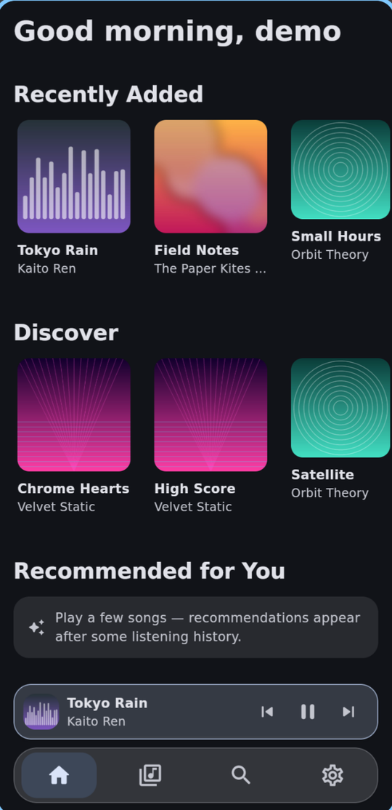
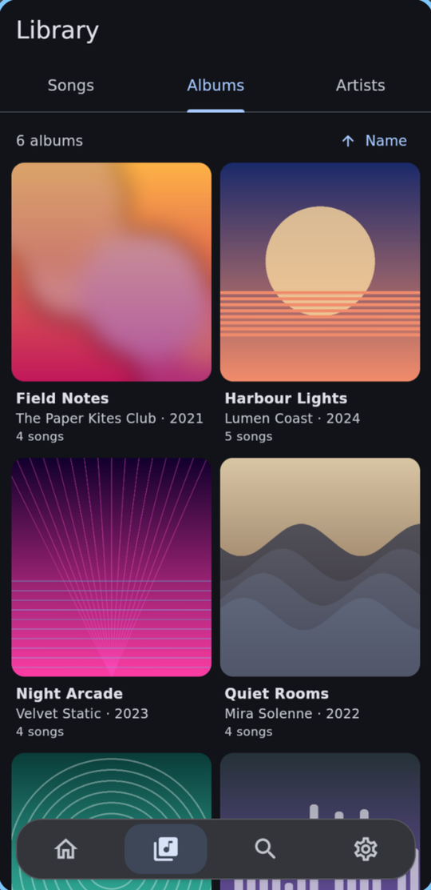
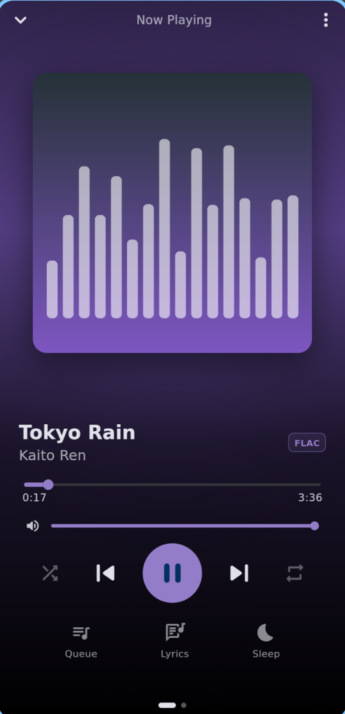
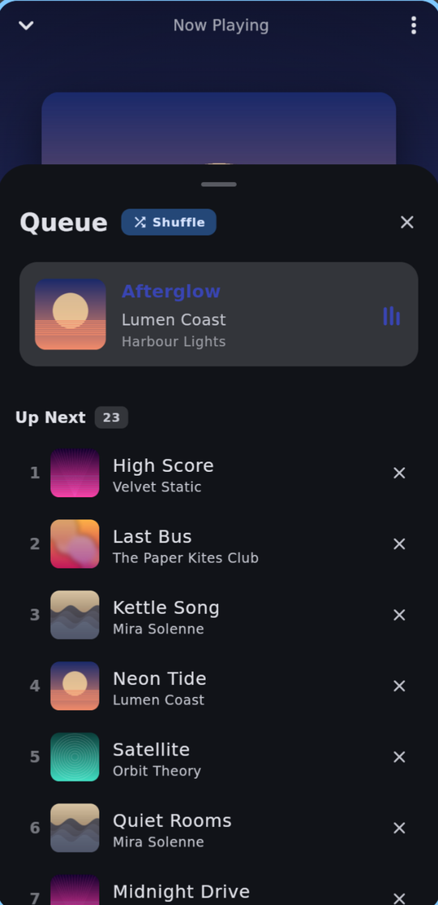

# Melodize

A music player for [Navidrome](https://www.navidrome.org/) and other Subsonic servers, for
Android, Linux and macOS. Lossless streaming, offline downloads, synced lyrics, a DJ-style smart
shuffle with automatic crossfades, and Deezer-powered discovery, in a Material 3 Expressive UI.

<p>
  
  
  
  
</p>

## Features

- Streams the original FLAC, Opus or MP3, or a transcode at 320, 192 or 128 kbps.
- Offline downloads: single songs, whole albums, or automatic (when played, or the whole library).
- Synced lyrics from LRCLIB that follow the song, with plain-text fallbacks.
- Queue: drag to reorder, play next, add to queue, swipe to remove, in every shuffle mode.
- Shuffle and **smart shuffle**, which orders the upcoming songs like a DJ set (tempo, key,
  energy, genre) and crossfades each pair automatically.
- Discovery from Deezer: recommendations from your listening history, "more like this",
  catalog search with 30-second previews.
- Light, dark and Material You themes; Now Playing takes its colors from the cover art.
- Scrobbling, sleep timer, lock-screen and media-key controls (MediaSession on Android, Now
  Playing on macOS, MPRIS on Linux) and keyboard shortcuts on desktop.

The optional [companion](docs/companion.md), a small Python service next to Navidrome, adds real
audio analysis for smart shuffle, server-rendered DJ transitions, deleting songs from the server,
and downloading Deezer tracks into the library. Melodize works fully without it.

## Install

Download the APK (Android 8+) or the Linux tarball from
[Releases](https://github.com/Catgirl-meow/melodize/releases), then enter your server URL,
username and password. Linux needs libmpv. macOS is built from source for now.
Details per platform: [docs/INSTALL.md](docs/INSTALL.md).

## Develop

The repo expects a Flutter 3.44 SDK checkout at `./flutter/` (git-ignored).

```sh
./flutter/bin/flutter pub get
./flutter/bin/flutter run                  # Linux desktop is the fast loop
./flutter/bin/flutter analyze lib test
./flutter/bin/flutter test
scripts/test-navidrome.sh up               # throwaway Navidrome + test library (podman)
eval "$(scripts/test-navidrome.sh env)"    # flutter test then also runs test/live/
```

More: [architecture and gotchas](CLAUDE.md), [roadmap](docs/roadmap.md),
[design conventions](docs/design.md), [security audit (Oct 2026)](docs/audit-2026-10.md).

## Credits and licenses

Melodize is licensed under the [MIT license](LICENSE).

- **Navidrome** ([navidrome/navidrome](https://github.com/navidrome/navidrome), GPL-3.0) and the
  [Subsonic API](http://www.subsonic.org/pages/api.jsp): the server and protocol Melodize talks
  to. Melodize is an independent project, not affiliated with either.
- **Deezer** ([public API](https://developers.deezer.com/api)): recommendations, search and
  previews. Not affiliated with or endorsed by Deezer; "Deezer" is their trademark.
- **Lyrics**: [LRCLIB](https://lrclib.net) and [lyrics.ovh](https://lyrics.ovh).
- **App**: [Flutter](https://flutter.dev) (BSD-3-Clause),
  [just_audio](https://pub.dev/packages/just_audio) and
  [audio_service](https://pub.dev/packages/audio_service) (MIT),
  [media_kit](https://github.com/media-kit/media-kit) (MIT) with [mpv](https://mpv.io) on Linux,
  [just_audio_media_kit](https://pub.dev/packages/just_audio_media_kit) (Unlicense),
  [Riverpod](https://riverpod.dev) (MIT), [drift](https://drift.simonbinder.eu) (MIT),
  [dio](https://pub.dev/packages/dio) (MIT),
  [cached_network_image](https://pub.dev/packages/cached_network_image) (MIT),
  [dynamic_color](https://pub.dev/packages/dynamic_color) (Apache-2.0),
  [palette_generator](https://pub.dev/packages/palette_generator) and
  [connectivity_plus](https://pub.dev/packages/connectivity_plus) (BSD-3-Clause),
  [dbus](https://pub.dev/packages/dbus) (MPL-2.0).
- **Companion**: [librosa](https://librosa.org) and
  [pyrubberband](https://github.com/bmcfee/pyrubberband) (ISC), [NumPy](https://numpy.org) and
  [soundfile](https://github.com/bastibe/python-soundfile) (BSD-3-Clause). It calls, but does not
  bundle, [deemix](https://gitlab.com/RemixDev/deemix-py) (GPL-3.0),
  [yt-dlp](https://github.com/yt-dlp/yt-dlp) (Unlicense) and [FFmpeg](https://ffmpeg.org).
- Screenshots show a made-up demo library; the artists, albums and covers do not exist.
